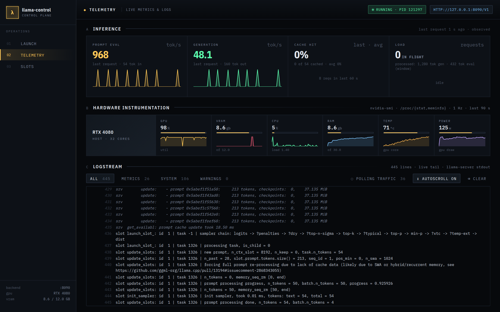
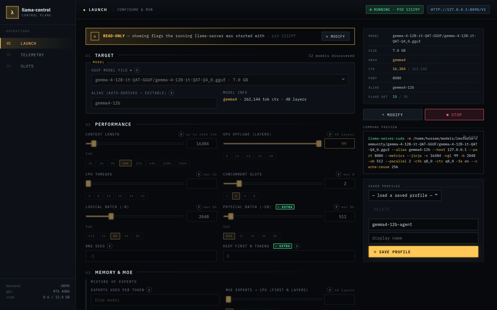

# llama-control

A small local control panel + live ops dashboard for `llama-server` (llama.cpp).




 Built to scratch a specific itch: LM Studio's UI hides the flags that actually matter for agent workloads (`--cache-reuse`, `-ub`, `--jinja`, `--metrics`), and gives you no real visibility into prefix-cache hits, KV state, or per-request prompt-eval times.

This is not a model browser or chat client. It does four things:

1. **Launcher** — scan a folder for `.gguf` files, fill a form of every llama-server flag (LM Studio's set plus the missing-but-useful ones), save sets of flags as named profiles, start/stop the server.
2. **Dashboard** — live charts for prompt-processing tok/s, generation tok/s, KV-cache usage, GPU utilisation, VRAM, temperature, power.
3. **Logs** — tailed `llama-server` stdout/stderr via SSE.
4. **Slots** — live per-slot KV cache state from `/slots`.

## Stack

- **Backend**: Spring Boot 3.4 / Java 21 — `backend/` (Google Java Style via checkstyle, JUnit)
- **Frontend**: Vite + React + TypeScript — `frontend/` (eslint with the React hooks rules)
- CI runs `mvn verify` and `npm run lint && npm run build` on every push.

The backend supervises one `llama-server` child process at a time, drains its merged stdout into a ring buffer (broadcast over SSE), polls `/metrics`, `/slots`, and `nvidia-smi` every 1 s, and proxies the snapshot to the frontend (also over SSE).

## Configure

Defaults live in `backend/src/main/resources/application.yml`. Most useful overrides:

```yaml
llama-control:
  binary: llama-server                    # name on PATH or absolute path of the binary to launch
  model-dirs: ${user.home}/models         # one or more roots to scan for .gguf, comma-separated
  profiles-dir: ${user.home}/.config/llama-control/profiles
  default-server-host: 127.0.0.1
  default-server-port: 8080
```

Both can be overridden without editing config:

```bash
LLAMA_CONTROL_BINARY=/opt/llama.cpp/llama-server \
LLAMA_CONTROL_MODEL_DIRS=/srv/models,/mnt/fast/models \
./mvnw spring-boot:run
```

## Run (dev)

Two terminals:

```bash
# terminal 1 — backend on :8090
cd backend && ./mvnw spring-boot:run

# terminal 2 — frontend on :5173
cd frontend && npm install && npm run dev
```

Open `http://127.0.0.1:5173`.

## Flag coverage

Every LM Studio "load model" flag, plus the high-value ones LM Studio doesn't surface:

| Group | Flags |
|---|---|
| Model | `-m`, `--alias` |
| Server | `--host`, `--port`, `--api-key`, `--metrics` ⚡, `--jinja` ⚡ |
| Compute | `-c`, `-ngl`, `-t`, `-b`, `-ub` ⚡, `--parallel`, `-s`, `--keep` ⚡ |
| MoE | `--n-cpu-moe`, `--cpu-moe` |
| KV cache | `--kv-unified`, `-nkvo`, `-ctk`, `-ctv`, `-fa` |
| Memory | `--mlock`, `--no-mmap` |
| **Caching** | `--cache-reuse` ⚡ — the missing-from-LM-Studio knob that fixes coding-agent prompt-processing latency |
| RoPE | `--rope-freq-base`, `--rope-freq-scale`, `--rope-scaling` |
| Escape hatch | free-form extra args appended verbatim |

⚡ = not exposed by LM Studio's UI.

## Point a coding agent at it

The launcher's status pill shows the OpenAI-compatible base URL once a server is running, typically `http://127.0.0.1:8080/v1`. Configure your client (OpenCode, Continue, etc.) as an OpenAI-compatible provider against that URL — any API key works unless you set one with `--api-key`.

## Verifying prefix caching actually works

Once a server is running, hit the same prefix twice:

```bash
curl -s http://127.0.0.1:8080/v1/completions -d '{
  "model": "qwen3-0.6b",
  "prompt": "Once upon a time in a faraway land there lived a wise old wizard who",
  "max_tokens": 5, "temperature": 0
}' | jq .usage

curl -s http://127.0.0.1:8080/v1/completions -d '{
  "model": "qwen3-0.6b",
  "prompt": "Once upon a time in a faraway land there lived a wise old wizard who knew all about",
  "max_tokens": 5, "temperature": 0
}' | jq .usage
```

On the second response, `usage.prompt_tokens_details.cached_tokens` should equal the length of the shared prefix. In the Logs tab you'll also see `prompt eval time = ...` shrink from the full prompt size to only the new tokens.

## Backend API (reference)

| Method | Path | Notes |
|---|---|---|
| GET | `/api/health` | liveness |
| GET | `/api/models` | scan model-dirs for `.gguf` |
| GET/POST/PUT/DELETE | `/api/profiles[/{id}]` | profile CRUD |
| GET | `/api/server/status` | current process state |
| POST | `/api/server/start/{id}` | start by saved profile id |
| POST | `/api/server/start` | start with inline profile body |
| POST | `/api/server/stop` | stop the supervised process |
| GET | `/api/logs` | full ring buffer snapshot |
| GET | `/api/logs/stream` | SSE stream of new lines (sends backlog first) |
| GET | `/api/metrics` | latest snapshot (llama-server `/metrics` + `/slots` + `nvidia-smi`) |
| GET | `/api/metrics/stream` | SSE stream, 1 event / sec |

## Files

```
llama-control/
├── backend/                              Spring Boot
│   ├── src/main/java/de/sweid/llamactl/
│   │   ├── LlamaControlApplication.java
│   │   ├── api/                          REST controllers
│   │   ├── config/                       Properties + CORS
│   │   ├── model/                        Records: ModelFile, LlamaFlags, Profile, ServerStatus, MetricsSnapshot
│   │   └── service/                      FlagsRenderer, ModelScanner, ProfileService, LlamaServerService, LogBuffer, MetricsPoller, …
│   └── pom.xml
└── frontend/                             Vite + React + TS
    └── src/
        ├── App.tsx                       tabs + global status
        ├── api.ts                        typed fetch helpers + SSE
        ├── types.ts
        ├── pages/                        LauncherPage, DashboardPage, LogsPage, SlotsPage
        ├── components/                   FlagField, RangeField, FlagPreview, CliPreview, Sparkline, …
        └── lib/                          renderArgs (argv from the form), flagHelp, aliasFromPath
```

## Development

```bash
cd backend && ./mvnw verify            # checkstyle + tests
cd frontend && npm run lint && npm run build
```
